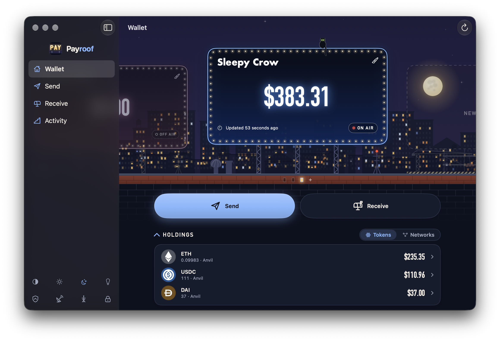

# Payroof

Accept crypto payments on EVM chains without ever handing over a spending key.



[](https://github.com/payroof/payroof/actions/workflows/ci.yml)
[](https://crates.io/crates/payroof)
[](#license)

Payroof gives each order its own payment address, watches the chains for money
arriving, and tells your app with a signed webhook. It only knows public keys, so it
can watch your addresses but can never spend from them.

A public server runs at [`api.payroof.top`](https://payroof.top), ready for Payroof Wallet and Stor. Or run your own.

## Features

- **Watch-only**: one deterministic address per reference, spendable only from your wallet.
- **Multichain**: native coins and ERC-20 tokens on the EVM chains you configure.
- **Signed webhooks**: `seen` and `confirmed` events, HMAC-signed and retried.
- **Scoped access**: revocable per-project credentials.
- **Small**: one static binary with SQLite.

## Install

- Homebrew: `brew install payroof/tap/payroof`
- Cargo: `cargo install payroof`
- Docker: `docker pull ghcr.io/payroof/payroof:0.1.0` (see [`compose.yaml`](compose.yaml))
- Prebuilt binaries: see [GitHub Releases](https://github.com/payroof/payroof/releases).

## Quick start

```sh
curl -O https://raw.githubusercontent.com/payroof/payroof/main/config/payroof.example.toml
cp payroof.example.toml payroof.toml          # then set `origin`
export PAYROOF_ALTCHA_KEY=$(openssl rand -hex 32) \
       PAYROOF_CURSOR_KEY=$(openssl rand -hex 32) \
       PAYROOF_MASTER_KEY=$(openssl rand -hex 32)
payroof payroof.toml
curl -fsS http://127.0.0.1:8080/readyz
```

With Docker, use `docker compose up -d` instead of the `payroof` command; see
[operations](docs/operations.md).

## Configuration

One TOML file plus three secret keys in the environment. Payroof watches exactly the
chains and assets you list. See the [configuration guide](docs/configuration.md).

## Documentation

- [HTTP API reference](docs/http-api.md)
- [Configuration](docs/configuration.md)
- [Operations](docs/operations.md): Docker, health checks, backups, releases
- [Architecture and security](docs/architecture.md)
- [Development](docs/development.md)
- [Changelog](CHANGELOG.md)

## License

Licensed under either of [Apache License 2.0](LICENSE-APACHE) or
[MIT](LICENSE-MIT), at your option.
